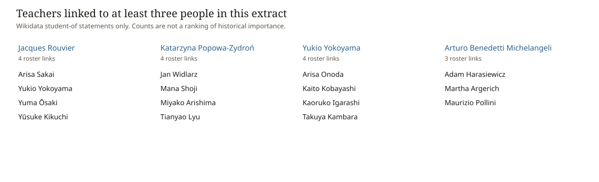

# Teacher links among Chopin Competition pianists, as stated by Wikidata

Which Chopin Competition pianists shared a teacher, and how many have a teacher listed in Wikidata? This project maps the recorded links and measures how much of the roster they cover.

The question is narrow: among people Wikidata lists for the International Chopin Piano Competition, which teacher relationships are actually recorded, and what does that pattern of recording show?

## Portfolio snapshot

The dated Wikidata extract contains 144 competition-roster people and 129 stated student–teacher links; only 65 roster people have at least one teacher statement. Wikidata listed at least one teacher for 65 of the 144 pianists in this snapshot, about 45%. The figure shows the four teachers linked to at least three pianists on the roster. The figure below shows the four teachers linked to at least three roster people in this extract.



See the teacher counts below for a text version of the figure.

## What was retrieved

The extract was downloaded on 30 October 2026 from Wikidata.

- The competition is [Q857351](https://www.wikidata.org/wiki/Q857351), the International Chopin Piano Competition.
- The roster query treats the items linked by `P527` (has part) as edition candidates.
- A person is in the roster when an edition lists them as winner (`P1346`) or participant (`P710`), or when the competition item itself lists them as winner.
- A line is kept only when that person's Wikidata item states `P1066` (student of).

The saved graph uses only relationships retrieved by the Wikidata extract. A missing outgoing link means the extraction did not return a teacher for that roster member. It makes no claim about whether the pianist studied with a teacher.

The saved extract contains 144 roster people and 129 teacher links to 98 teachers. Of the 144, 65 have at least one teacher statement and 79 have none. This is a dated observational snapshot, not a complete history of piano pedagogy.

## Reproducibility and provenance

There are two deliberately separate workflows:

1. `python analysis.py` reproduces the published tables and figure from the dated CSV snapshot in `data/`.
2. `python extract_wikidata.py` reruns the versioned SPARQL logic against live Wikidata and writes a **new** snapshot to `data/refresh/`.

Live Wikidata changes, so a refresh can produce different counts. The refresh script records the UTC time at the end of the export, endpoint, counts, and query hashes in `metadata.json`; it does not overwrite the saved application snapshot when using the default output directory. The query files document the roster and `student of` rules, while each refreshed edge also records the Wikidata statement URL, statement rank, and number of distinct attached Wikidata reference nodes for the pair. Statement URLs and ranks are stored as separate sets, so the edge table cannot identify which reference or rank belongs to each individual statement. A reference count of zero indicates that the query returned no attached reference node. Assessing the historical claim requires a source audit.

A separate audit on 31 October 2026 reported attached Wikidata references for 35 of 129 links. The audit inputs are absent from this repository. The saved CSVs reproduce the network counts above. The saved four-column edge table has no reference fields, and the inputs of that audit are not included here. The graph supports a claim about retrieved Wikidata statements. Historical verification requires examining the underlying statement and its sources.

## What the numbers mean

`python analysis.py` recomputes these figures from `data/nodes.csv` and `data/edges.csv`.

Teacher counts are not a ranking of historical importance. Teacher records vary in detail across the roster. A teacher’s count can depend on how thoroughly their students’ entries are documented. A teacher can therefore stand high in this extract because the page is detailed, not because that teacher shaped the competition.

Four teachers are linked to at least three roster people:

| Teacher | Roster people stated as students | Wikidata |
| --- | --- | --- |
| Yukio Yokoyama | 4 | [Q9383588](https://www.wikidata.org/wiki/Q9383588) |
| Jacques Rouvier | 4 | [Q1365596](https://www.wikidata.org/wiki/Q1365596) |
| Katarzyna Popowa-Zydroń | 4 | [Q748228](https://www.wikidata.org/wiki/Q748228) |
| Arturo Benedetti Michelangeli | 3: Martha Argerich, Maurizio Pollini, Adam Harasiewicz | [Q318633](https://www.wikidata.org/wiki/Q318633) |

The full list is `output/teacher_degree.csv`. Every name links back to a Wikidata item.

Treating each link as an undirected tie gives 105 weakly connected components, of which 32 contain at least two nodes. Of the 79 roster members without a recorded outgoing teacher edge, 73 are isolated and six still appear as teachers. The largest component has 31 nodes and 30 edges. It is not one piano school: it joins several teacher groups, and it includes Wikidata's statements that Yukio Yokoyama was a student of Herbert von Karajan and of Mstislav Rostropovich. Those two statements are kept because they are on the item. They should be checked on the item before they are described as piano teaching. His item is [Q9383588](https://www.wikidata.org/wiki/Q9383588).

## Edge identity and coverage

The graph uses Wikidata QIDs for identity and display labels for presentation.
Each saved edge points from a roster member to a named teacher. Edges are
unweighted. The saved teacher table counts distinct student display labels per
teacher, which agrees with distinct student QIDs in this snapshot. Homonyms or
aliases can cause these counts to diverge in a different snapshot.

Roster coverage counts students whose QIDs appear in both the roster and the
edge table. The teacher table groups all edge rows. For another input, check
that node QIDs are unique, every pair is unique, both endpoints exist, and every
student endpoint belongs to the roster before interpreting the counts.

The live refresh groups the full P1066 statement results by the ordered
student–teacher QID pair. This includes deprecated ranks. Roster and edge
queries run separately, and a student returned only by the edge query is added
to the refreshed roster. If labels differ, roster labels take precedence for
roster nodes, while edge labels come from the first matching pair row. Keep the
reference count and statement rank as provenance fields.

## Running a refresh safely

Run the refresh from the repository root with the Wikidata Query Service query
files. Use a separate output directory for each run. Passing the saved input
directory as the output directory can overwrite its CSVs. Nodes, edges, and
metadata are written in sequence. Verify all three files before using a
refresh. The JSON ignore pattern also matches refresh metadata, so retain its
copy alongside the exact input tables when archiving a research run.

The analysis command reads the saved tables by default. The output date
represents the fixed 30 October 2026 snapshot. The current tables do not retain
competition edition membership or teaching dates. A study of change across
cohorts would need independently sourced edition dates and evidence for the
timing and type of instruction.

## How to read a row

`data/edges.csv` has `student_qid`, `student_name`, `teacher_qid`, and `teacher_name`. Open `https://www.wikidata.org/wiki/` plus the student QID and look at the property `student of`.

`data/nodes.csv` marks each person as `roster` (competition list only), `teacher` (named by someone in the roster), or `both`.

## Repository layout

```text
chopin-competition-teacher-network/
├── data/nodes.csv              # 144 roster people plus the teachers they name
├── data/edges.csv              # 129 student-of links copied from Wikidata
├── queries/roster.rq           # competition roster query
├── queries/teacher_links.rq    # roster-to-teacher query
├── output/summary.csv          # coverage and component counts
├── output/teacher_degree.csv   # how many roster people name each teacher
├── output/core_teachers.svg    # the four teachers with three or more links
├── tests/test_snapshot.py      # integrity checks for the dated snapshot
├── extract_wikidata.py         # creates a separate live-data refresh
├── analysis.py                 # recomputes the output from the CSV files
└── README.md
```

```powershell
python analysis.py
python -m unittest discover -s tests -v

# Optional: query current Wikidata without changing data/
python extract_wikidata.py --output-dir data/refresh
```

`analysis.py` never downloads Wikidata; the CSV files are the fixed input to the reported analysis.
