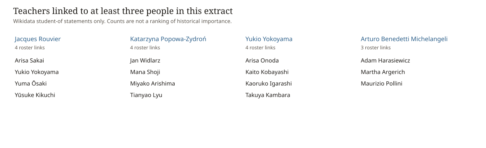

# Teacher links among Chopin Competition pianists, as stated by Wikidata

An independent computational-musicology project about data provenance, missingness, and network interpretation.

The question is narrow: among people Wikidata lists for the International Chopin Piano Competition, which teacher relationships are actually recorded, and what does that pattern of recording show?

## What was retrieved

The extract was downloaded on 30 October 2026 from Wikidata.

- The competition is [Q857351](https://www.wikidata.org/wiki/Q857351), the International Chopin Piano Competition.
- Its editions are the items linked by `P527` (has part).
- A person is in the roster when an edition lists them as winner (`P1346`) or participant (`P710`), or when the competition item itself lists them as winner.
- A line is kept only when that person's Wikidata item states `P1066` (student of).

No teacher was added from a biography, a recording note, or memory. If a well-known lesson is missing, Wikidata did not state it on this date.

The saved extract contains 144 roster people and 129 teacher links to 98 teachers. Of the 144, 65 have at least one teacher statement and 79 have none. This is a dated observational snapshot, not a complete history of piano pedagogy.

## Reproducibility and provenance

There are two deliberately separate workflows:

1. `python analysis.py` reproduces the published tables and figure from the dated CSV snapshot in `data/`.
2. `python extract_wikidata.py` reruns the versioned SPARQL logic against live Wikidata and writes a **new** snapshot to `data/refresh/`.

Live Wikidata changes, so a refresh may not reproduce the 30 October 2026 counts. The refresh script records retrieval time, endpoint, counts, and query hashes in `metadata.json`; it does not overwrite the saved application snapshot. The query files document the roster and `student of` rules, while each refreshed edge also records the Wikidata statement URL, statement rank, and number of attached reference records. A reference count of zero is a warning to verify the relationship independently, not evidence that it is false.

An audit run on 31 October 2026 found an attached Wikidata reference record for 35 of the 129 P1066 links; 94 had no attached reference. Consequently, this project makes the narrow, reproducible claim that these relationships were **stated in Wikidata**, not that all 129 have been independently verified as historical facts.

## What the numbers mean

`python analysis.py` recomputes these figures from `data/nodes.csv` and `data/edges.csv`.

Teacher counts are not a ranking of historical importance. Older laureates are often missing a teacher statement, while some recent participants have several. A teacher can therefore stand high in this extract because the page is detailed, not because that teacher shaped the competition.

Four teachers are linked to at least three roster people:

| Teacher | Roster people stated as students | Wikidata |
| --- | --- | --- |
| Yukio Yokoyama | 4 | [Q9383588](https://www.wikidata.org/wiki/Q9383588) |
| Jacques Rouvier | 4 | [Q1365596](https://www.wikidata.org/wiki/Q1365596) |
| Katarzyna Popowa-Zydroń | 4 | [Q748228](https://www.wikidata.org/wiki/Q748228) |
| Arturo Benedetti Michelangeli | 3: Martha Argerich, Maurizio Pollini, Adam Harasiewicz | [Q318633](https://www.wikidata.org/wiki/Q318633) |



The full list is `output/teacher_degree.csv`. Every name links back to a Wikidata item.

Treating each link as an undirected tie gives 105 components. Most roster people are isolated because no teacher is stated. 32 components contain at least two people. The largest has 31. It is not one piano school: it joins several teacher groups, and it includes Wikidata's statements that Yukio Yokoyama was a student of Herbert von Karajan and of Mstislav Rostropovich. Those two statements are kept because they are on the item. They should be checked on the item before they are described as piano teaching. His item is [Q9383588](https://www.wikidata.org/wiki/Q9383588).

## How to read a row

`data/edges.csv` has `student_qid`, `student_name`, `teacher_qid`, and `teacher_name`. Open `https://www.wikidata.org/wiki/` plus the student QID and look at the property `student of`.

`data/nodes.csv` marks each person as `roster` (competition list only), `teacher` (named by someone in the roster), or `both`.

## Repository layout

```text
chopin-competition-teacher-network/
├── data/nodes.csv              # 144 roster people plus the teachers they name
├── data/edges.csv              # 129 student-of links copied from Wikidata
├── queries/roster.rq           # competition roster query
├── queries/teacher_links.rq    # roster-to-teacher query
├── output/summary.csv          # coverage and component counts
├── output/teacher_degree.csv   # how many roster people name each teacher
├── output/core_teachers.svg    # the four teachers with three or more links
├── tests/test_snapshot.py      # integrity checks for the dated snapshot
├── extract_wikidata.py         # creates a separate live-data refresh
├── analysis.py                 # recomputes the output from the CSV files
└── README.md
```

```powershell
python analysis.py
python -m unittest discover -s tests -v

# Optional: query current Wikidata without changing data/
python extract_wikidata.py --output-dir data/refresh
```

`analysis.py` never downloads Wikidata; the CSV files are the fixed input to the reported analysis.
